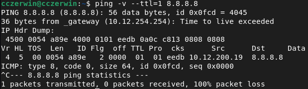

Subject Version 5

## Description

[Ping](https://en.wikipedia.org/wiki/Ping_(networking_utility)) (**P**acket **IN**ternet **G**roper) is the name of a command that allows to test the accessibility of another machine through the IP network. The command measures also the time taken to receive a response, called round-trip time.


> exemple of a ping command

This project must be done in a Debian virtual machine (version >= 7.0)  
Done on Debian 13 (Trixie) with inetutils 2.6

- The executable must be named ft_ping.
- Except for the RTT line and the reverse DNS resolution, the result must have an indentation identical to the implementation from inetutils-2.0.  
**inetutils-ping** is the portable GNU implementation, which is used on non-Linux or alternative GNU operating systems.

**iputils-ping** is Linux only, but does have more features. If you are using Linux, you probably want iputils version of ping.

- Manage the `-v` and `-?` options  
`-v` or `--verbose` = Verbose output. ICMP packets other than ECHO_RESPONSE that are received are listed.  
`-?` or `--help`  to show the help command 

  
>*exemple of diagnostic with -v enabled*

- Manage simple IPv4 (address/hostname) as parameters
- Manage the [FQDN](https://en.wikipedia.org/wiki/Fully_qualified_domain_name) without doing the DNS resolution in the packet return

- Using the libc functions is allowed
- All the prinf familly functions are allowed
- Usage of excve, ping, fcntl, poll and ppoll is strictly forbidden.

Ping send ICMP packets (different protocol than TCP/UDP) ~
[ICMP Wikipedia page](https://en.wikipedia.org/wiki/Internet_Control_Message_Protocol)

## Bonus Part

Manage additionals flags such as: ([inetutils-ping man page](https://manpages.debian.org/trixie/inetutils-ping/ping.1.en.html))

- `-f` or `--flood` = [Flood ping](https://en.wikipedia.org/wiki/Ping_flood). Outputs packets as fast as they come back or one hundred times per second, whichever is more. For every ECHO_REQUEST sent a period ``.'' is printed, while for every ECHO_REPLY received a backspace is printed. This provides a rapid display of how many packets are being dropped. Only the super-user may use this option. This can be very hard on a network and should be used with caution.

- `--ip-timestamp <flag>` = define timestamp, can be one of <tsonly|tsandaddr>  
`tsonly` = store timestamps only.  
`tsandaddr` = store timestamps plus each hop's address.  
Note that some host block or ignore such paquets because IP timestamp is an old and rarely used IP option.

- `-l <preload>` or `--preload <preload>` = If preload is specified, ping sends that many packets as fast as possible before falling into its normal mode of behavior.

---
- `-n` or `--numeric` = Numeric output only. No attempt will be made to lookup symbolic names for host addresses.

Ping exemples with and without the 'n' flag with the iputils-ping (inetutils-ping gave me twice the bottom result)
```shell
>ping manpages.debian.org
PING static.debian.org (194.177.211.216) 56(84) bytes of data.
64 bytes from static-mirror-grnet-01.debian.org (194.177.211.216): icmp_seq=1 ttl=46 time=53.6 ms
```
```shell
>ping manpages.debian.org -n
PING static.debian.org (194.177.211.216) 56(84) bytes of data.
64 bytes from 194.177.211.216: icmp_seq=1 ttl=46 time=53.7 ms

```

---

- `-p <pattern>` or `--pattern <pattern>`= You may specify up to 16 "pad" bytes to fill out the packet you send. This is useful for diagnosing data-dependent problems in a network. For example, "-p ff" will cause the sent packet to be filled with all ones.

- `-r` or `--ignore-routing` = Bypass the normal routing tables and send directly to a host on an attached network. If the host is not on a directly-attached network, an error is returned. This option can be used to ping a local host through an interface that has no route through it (e.g., after the interface was dropped by routed(8)).

- `-s <packetsize>` or `--size <packetsize>` = Specifies the number of data bytes to be sent. The default is 56, which translates into 64 ICMP data bytes when combined with the 8 bytes of ICMP header data.

- `--ttl` = define the packet time to live (ttl)

- `-T <num>` or `--tos <num>` = Set <num> as the packet type of service (ToS request specific treatment i.e packet priority).

- `-w <deadline>` or `--timeout <deadline>`= stop after <deadline> in seconds (global timeout)

- `-W <timeout>` or `--linger <timeout>` = time to wait for response (timeout per replies)

**Note:**
- the flags -V, -usage, -echo are not considered as bonus  
`-V` prints the ping version and exits.
`-usage` gives an exemple of command usage and argument order.  
`-echo` Send ICMP_ECHO packets (default).  

- two flags corresponding to the same feature (eg: -t and -type) are not considered as two bonuses  
`-t or -type` is used to send type packets.


## Usage

**ping [option ...] host ...**

A flag start with a '-' or '--', it can be in any position

### A simple ping command:  
```shell
>ping 127.0.0.1
PING 127.0.0.1 (127.0.0.1) 56(84) bytes of data.
64 bytes from 127.0.0.1: icmp_seq=1 ttl=64 time=0.024 ms
64 bytes from 127.0.0.1: icmp_seq=2 ttl=64 time=0.041 ms
64 bytes from 127.0.0.1: icmp_seq=3 ttl=64 time=0.025 ms
^C
--- 127.0.0.1 ping statistics ---
3 packets transmitted, 3 received, 0% packet loss, time 2043ms
round-trip min/avg/max/stddev = 0.024/0.030/0.041/0.007 ms
	exit code = 0
```


### In the case a given flag is **not** recognized:
```shell
>ping -z 127.0.0.1
ping: invalid option -- 'z'
Try 'ping --help' or 'ping --usage' for more information.
	exit code = 64
```


### Multiple hostnames
```shell
>ping 127.0.0.1 www.google.com -c5
	exit code = 0
```
This would ping `127.0.0.1` (-c5 tells ping to stop after 5 requests) then proceed with `www.google.com`

### Call without argument:
```shell
>ping
ping: missing host operand
Try 'ping --help' or 'ping --usage' for more information.
	exit code = 64
```

### Invalid hostname:
```shell
>ping www.test.123
ping: unknown host
	exit code = 1
```

## Misc

Argument and their values can be written as `ping hostname -w 2` or `ping hostname -w2`  

`ping hostname -fw2` is valid, '-f' does not require any value  
`ping hostname -w2c1` is invalid, '-w' wait a value, you can't input another flag here, you should instead write them as separate arguments.  

## Delete later ig

Install wireshark?

Sending:
open a raw ICMP socket
Make the ICMP request (type 8 = echo request)
Send using sendto


Receiving:
(We see ALL the ICMP requests here)
Identify which request concern us (type 0 = echo answer)
Verify which PID is concerned
Verify checksum
Check the timestamp to calculate the round-trip time
Check ttl
Report result

