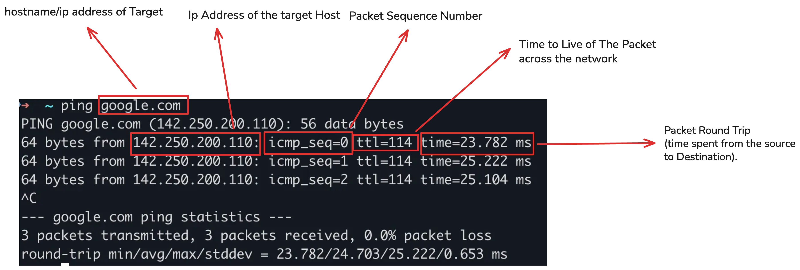

Subject Version 5

Ping is the name of a command that allows to test the accessibility of another machine through the IP network. The command measures also the time taken to receive a response, called round-trip time.

This project must be done in a Debian virtual machine (version >= 7.0)  
Done on Debian 13 (Trixie) with inetutils 2.6

- The executable must be named ft_ping.
- Except for the RTT line and the reverse DNS resolution, the result must have an indentation identical to the implementation from inetutils-2.0.  
**inetutils-ping** is the portable GNU implementation, which is used on non-Linux or alternative GNU operating systems.

**iputils-ping** is Linux only, but does have more features. If you are using Linux, you probably want iputils version of ping.

- Manage the -v and -? options  
-v = Verbose output. ICMP packets other than ECHO_RESPONSE that are received are listed.  
-? is an equivalent to -h (--help) in some build to show the help command  

- Manage simple IPv4 (address/hostname) as parameters
- Manage the [FQDN](https://en.wikipedia.org/wiki/Fully_qualified_domain_name) without doing the DNS resolution in the packet return

- Using the libc functions is allowed
- All the prinf familly functions are allowed
- Usage of excve, ping, fcntl, poll and ppoll is strictly forbidden.

Bonus Part

Manage additionals flags such as:

- `-f` = [Flood ping](https://en.wikipedia.org/wiki/Ping_flood). Outputs packets as fast as they come back or one hundred times per second, whichever is more. For every ECHO_REQUEST sent a period ``.'' is printed, while for every ECHO_REPLY received a backspace is printed. This provides a rapid display of how many packets are being dropped. Only the super-user may use this option. This can be very hard on a network and should be used with caution.

- `-l <preload>` = If preload is specified, ping sends that many packets as fast as possible before falling into its normal mode of behavior.
- `-n` = Numeric output only. No attempt will be made to lookup symbolic names for host addresses.

- `-w <deadline>` = reply wait <deadline> in seconds (global timeout)

- `-W <timeout>` = time to wait for response (timeout per replies)

- `-p <pattern>` = You may specify up to 16 ``pad'' bytes to fill out the packet you send. This is useful for diagnosing data-dependent problems in a network. For example, "-p ff" will cause the sent packet to be filled with all ones.

- `-r` = Bypass the normal routing tables and send directly to a host on an attached network. If the host is not on a directly-attached network, an error is returned. This option can be used to ping a local host through an interface that has no route through it (e.g., after the interface was dropped by routed(8)).

- `-s <size>` = Specifies the number of data bytes to be sent. The default is 56, which translates into 64 ICMP data bytes when combined with the 8 bytes of ICMP header data.

- `-T <num>` = Set num as the packet type of service (ToS request specific treatment i.e packet priority).

- `--ip-timestamp <flag>` = define timestamp, can be one of <tsonly|tsandaddr>  
`tsonly` = store timestamps only.  
`tsandaddr` = store timestamps plus each hop's address.  
Note that some host block or ignore such paquets because IP timestamp is an old and rarely used IP option.

- `--ttl` = define the time to live

*Some descriptions are coming the debian [man](https://manpages.debian.org/stretch/inetutils-ping/ping.1.en.html) pages, some from elsewhere as not all those parameters seems to exist on every build

**Note:**
- the flags -V, -usage, -echo are not considered as bonus  
`-V` prints the ping version and exits.
`-usage` gives an exemple of command usage and argument order.  
`-echo` Send ICMP_ECHO packets (default).  

- two flags corresponding to the same feature (eg: -t and -type) are not considered as two bonuses  
`-t or -type` is used to send type packets.

Install wireshark?

Sending:
open a raw ICMP socket
Make the ICMP request (type 8 = echo request)
Send using sendto

Receiving:
(We see ALL the ICMP requests here)
Identify which request concern us (type 0 = echo answer)
Verify which PID is concerned
Check the timestamp to calculate the round-trip time
Check ttl
Report result